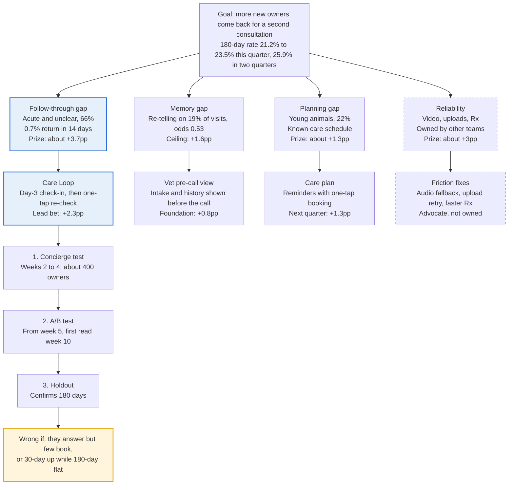
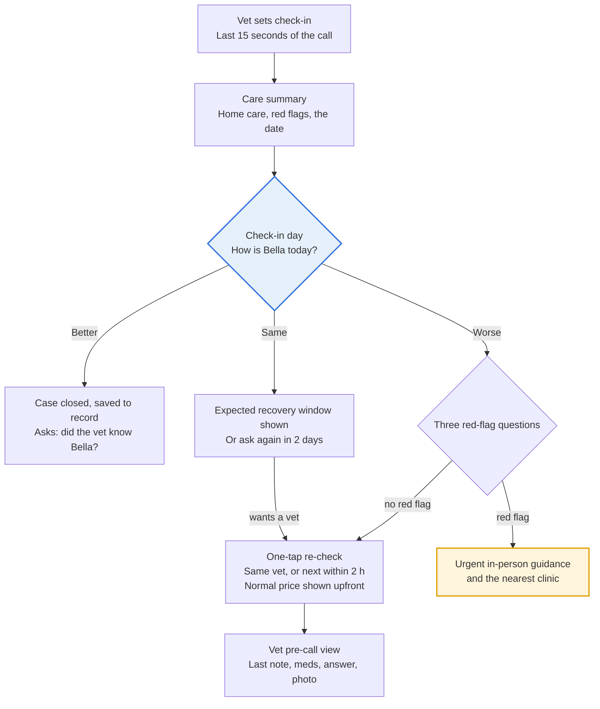

# PetDoc — From One-Off Consult to the Vet Who Checks Back

PetDoc wins the first visit (4.8 stars, NPS 65), then disappears from the owner's life: only 21.2% of new owners come back within 180 days. The visit ends when the call ends. This strategy closes the loop, so PetDoc checks back after an acute visit and remembers the pet when the owner returns.

I built this as the case study for the Senior Product Manager, Patient Experience role. Every section is a judgment call: which problem to solve and for whom, what to test first, what not to build, and where the leverage sits.

| 21.2% | 0.7% | +2.3pp | €12.71 to €13.32 |
| --- | --- | --- | --- |
| New owners back within 180 days today | Acute owners back within 14 days: the empty window | Care Loop lift this quarter, to 23.5% (range +0.8 to +3.6pp) | 180-day contribution per new owner, base case after two quarters |

All figures are re-computed from the case data: 1,413 consultations, 1,200 owners, first visits Aug 2025 to Jan 2026, each with a full 180 days. They are directional, and I replicate the baselines in PetDoc's warehouse in week 1 before committing targets. 

| # | Section | What it answers |
| --- | --- | --- |
| 01 | The goal | What we commit to this quarter, and the answer on one page |
| 02 | Problem framing | Where second visits leak, and the root causes |
| 03 | Strategic framework | Three levers, one loop |
| 04 | Initiative portfolio | What we build, in what order, and what we don't |
| 05 | Target audience | Who it is for, and what each persona gets |
| 06 | Care Loop deep dive | How the lead bet works, step by step |
| 07 | Experiments | Ten tests in three phases, with kill rules |
| 08 | Prototype | The moment where the hypothesis holds or fails |
| 09 | Metrics | What good looks like, and what stops us |
| 10 | Who I involve | Missions and functions, concept to implementation |
| 11 | Roadmap | Four quarters, gates and risks |
| 12 | Appendices | Sizing, method, principles, measurement, glossary, CTO FAQ, goal prompt |

## 01 The goal

This quarter: lift the 180-day second-consultation rate for new owners from 21.2% to 23.5%, proven inside the quarter through leading indicators, on the way to 25.9% in two quarters.

**Objective:** no first visit ends as a dead end. Every owner leaves with a reason to come back, and returns to a PetDoc that already knows their pet.

| Key result | Baseline | Target this quarter | Readable after |
| --- | --- | --- | --- |
| Acute re-check within 14 days (treated vs control) | 0.7% | at least 3% | 2 weeks |
| Acute return within 30 days | 2.2% | at least 4.5% | 4 weeks |
| Re-telling rate (vet asks for info already given) | 19% | under 10% | Every visit |
| 180-day second-consultation rate, exposed cohorts | 21.2% | 23.5% forecast, confirmed by holdout | 180 days |

Guardrails: rating 4.8 or higher, NPS 65 or higher, fewer than 15% of re-checks marked "not needed" by the vet, and acute new-episode return (today 13.6%) not falling.

> **Why 23.5% and not 25.9% this quarter?** A 180-day metric cannot be read inside a quarter. I commit to what Care Loop can prove now, and gate everything else on leading indicators.

| Question | Answer |
| --- | --- |
| Which problem | The visit ends when the call ends. Acute owners hear nothing while their pet recovers, so only 0.7% return within 14 days. Owners who do return are often asked to re-tell the story. |
| For which users | Primary: the worried one-timer (acute and unclear, 66% of new owners, 14% return). Protected: the care manager. Next quarter: the new pet parent. |
| Impact potential | Care Loop alone: about +2.3pp (range +0.8 to +3.6pp). With the memory fix and a care plan: about +4.7pp, to 25.9%. |
| The solution | Care Loop. The vet sets a check-in day; PetDoc asks "How is Bella today?"; "same" or "worse" becomes a one-tap re-check with the same vet, history attached. |
| How I prove it | Concierge test in weeks 2 to 4, A/B test from week 5 with a first read in week 10, run long enough to confirm the 180-day effect. |
| How I'd know I'm wrong | Owners answer but don't book (they want reassurance, not a visit). Or 30-day return rises while 180-day stays flat (returns were only pulled forward). |

**Goal tree: one bet carries the goal, one foundation makes it work**

Read it top down. Only the follow-through gap is large enough to move the goal, so Care Loop leads and the vet pre-call view carries it. Dashed boxes sit with other missions.

## 02 Problem framing: where second visits leak

The gap is not consult quality; it is everything around the consult. A family vet keeps owners by knowing the pet and checking back. PetDoc's journey does neither, and the 4.8-star rating hides it.

**Journey audit.** Each step of the owner journey, what goes wrong, and what the data says it costs. Severity combines how many owners it hits and how much it cuts return.

| Journey step | Observed issue | Evidence from the data | Return risk | Severity |
| --- | --- | --- | --- | --- |
| **Intake and uploads** (before the call) | Uploads fail; what the owner typed does not reach the vet | Upload failed on 8% (return 15.2% vs 21.7%); re-telling on 19% of first visits | Medium | High |
| **Waiting room** | Evening waits of 10 to 12 minutes vs 6 to 8 by day | Only waits over 15 minutes matter (16.0% vs 21.6%) | Low | Low |
| **The consult** | Vet asks for what the owner already gave; video drops | Re-telling odds 0.53 (p=0.003); video issue 5.6% vs 22.7% | High | Critical |
| **Prescription** | 28% of prescriptions take 5+ days; no tracking | Each extra day: odds 0.85 (p=0.006) | Medium | Medium |
| **Days 0 to 14 after the call** | Silence: no summary, no check-in, no path back to the same vet | Acute 14-day return 0.7%; 5 of 105 acute returners came back this early | High | **Critical** |
| **Days 15 to 180** | Nothing until the next problem | Acute returners come back around day 70, with a new episode | Medium | Medium |
| **The return visit** | Starts from zero again | Re-telling on 23% of second visits, the most loyal owners | High | Critical |

The chart (here as a table) shows the empty window: chronic owners are back at 29.5% by day 30, acute owners at 2.2%.

**Acute owners barely return in the first 30 days: 2.2% vs 29.5% for chronic.** Cumulative share of new owners with a second consultation, by days after the first visit.

| Segment | Within 14 days | Within 30 days | Within 60 days | Within 90 days | Within 180 days |
| --- | --- | --- | --- | --- | --- |
| Chronic | 11.4% | 29.5% | 42.3% | 49.0% | 51.0% |
| Young animal | 3.8% | 8.8% | 17.6% | 22.2% | 25.7% |
| All owners | 2.8% | 7.1% | 13.1% | 16.9% | 21.2% |
| **Acute** | **0.7%** | **2.2%** | 6.0% | 9.0% | 14.3% |

*Source: petdoc_case_data_EN.csv · 1,200 owners, first visit Aug 2025 to Jan 2026 · unclear segment (54) not shown*

**Owner voice.** Comment themes at consultation level, with the return rate of owners who wrote them. The most loyal theme is not "fast" or "cheap"; it is "they already knew my pet."

| Theme | Comments | Return | What owners say |
| --- | --- | --- | --- |
| Context present | 72 | 36% | "Everything was already on file, we got straight to the point." |
| Positive, other | 40 | 38% | "No waiting, no technical problems, helped right away." |
| Neutral | 60 | 28% | "It was fine. But no more than that." |
| Context lost (re-telling) | 53 | 25% | "There's a file, but apparently nobody read it." · "The same questions as last time." |
| Video or audio | 22 | 18% | "The sound kept cutting out. Next time I'll go back to the clinic." |
| Upload | 19 | 16% | "Error message when uploading, no explanation." |
| Delivery | 17 | 12% | "Shipment tracking is missing entirely." |
| Waiting | 13 | 8% | "Waited over twenty minutes." |

14 comments threaten to go "back to the clinic"; 6 of them are about re-telling, the largest single cause. Ratings miss this: re-telling moves the rating only from 4.35 to 3.89, yet cuts return by a third, and 68% of 5-star raters never return.

**Root causes.**

| # | Root cause | What it means | Evidence |
| --- | --- | --- | --- |
| RC1 | **The consult is a transaction, not an episode** | No follow-up moment exists after the call | Acute 14-day return 0.7% |
| RC2 | **Context does not travel** | Intake and history do not reach the vet, even within one visit | Re-telling on 19% of first and 23% of second visits |
| RC3 | **Ratings measure the call, not the relationship** | The team optimises what it sees: a 4.8-star call | 68% of 5-star raters never return |
| RC4 | **No plan for predictable needs** | Young animals have a known schedule; PetDoc ignores it | Young animal 25.7% return on a 45-day cadence |
| RC5 | **Reliability friction** | Video, uploads and delivery fail often enough to matter | +3pp combined if fixed; owned by other missions |
| RC6 | **Nobody measures context loss** | Re-telling is invisible on today's dashboards | No "vet knew my pet" metric exists |

> **Why lead with RC1 and not RC2?** RC2 has the strongest evidence, but removing re-telling entirely adds only +1.6pp. RC1 is the only cause large enough to move the goal, so I bet on it and de-risk it with a three-week concierge test. RC2 is fixed alongside, because a re-check that makes the owner re-tell recreates the problem.

Data caveats (the first visit in the sample may not be the first ever; no vet ID or diagnosis; small chronic group) are in Appendix B.

## 03 Strategic framework: three levers, one loop

A family vet keeps owners because they **follow up**, **remember**, and **plan ahead**. PetDoc's product does none of the three today, so each becomes a lever.

| Lever | What it means for the owner | Root cause | Main persona | Modelled lift | Share of in-mission lift | When |
| --- | --- | --- | --- | --- | --- | --- |
| **Follow up** | The visit does not end when the call ends | RC1 | Worried one-timer | +2.3pp | about 52% | Now |
| **Remember** | The vet already knows my pet | RC2, RC6 | Everyone; care manager most | +0.8pp (ceiling +1.6pp) | about 18% | Now, with Vet Experience |
| **Plan ahead** | PetDoc tells me what is due, and when | RC4 | New pet parent | +1.3pp | about 30% | Next quarter |

The three are one loop, not three features. Every closed episode feeds the pet record (Remember). The record personalises the care plan (Plan ahead). The plan and the check-in create the next visit (Follow up), which adds to the record again.

> **Why sequence Follow up and Remember first, when Plan ahead is a third of the lift?** The care plan needs a plan engine and species and age data we don't capture yet. It also faces a real risk: vaccinations need an in-person visit, so bookings may leak to local clinics. Follow up and Remember ship on data we have, and they build the record the plan needs.

**Positioning.** Competitors sell the same thing PetDoc does: a good one-off video consult, often free through insurers. None visibly owns what happens after the call. PetDoc can't win on price or 24/7 availability; it can win on *"the vet who remembers your pet and checks back."* Competitive detail is in Appendix A.

## 04 Initiative portfolio: seven initiatives, proof before scale

Each initiative maps to a root cause. Priority is impact times feasibility, then adjusted for dependencies. Every P1 runs on data PetDoc already has.

| ID | Initiative | Fixes | Persona | Lift | Impact (1 to 5) | Feasibility (1 to 5) | Priority | Ships |
| --- | --- | --- | --- | --- | --- | --- | --- | --- |
| IP-1A | **Care Loop:** vet-set check-in, one-tap re-check with the same vet, context attached | RC1 | Worried one-timer | +2.3pp | 5 | 4 | **P1** | Q1, weeks 5 to 10 |
| IP-1B | **Intake hand-off:** the owner's intake and uploads on the vet's screen before the call | RC2 | Everyone | part of +0.8pp | 4 | 4 | **P1** | Q1, with Vet Experience |
| IP-1C | **Measure and recover:** "vet knew my pet" survey, care summary, non-monetary service recovery | RC3, RC6 | Everyone | +0.3pp | 3 | 5 | **P1** | Q1, weeks 1 to 4 |
| IP-2A | **Thin pet record:** past consults, uploads and meds in the vet pre-call view | RC2 | Care manager | rest of +0.8pp | 4 | 3 | P2 | Q1 to Q2 |
| IP-2B | **Care plan:** species and age schedule, reminders, one-tap booking | RC4 | New pet parent | +1.3pp | 4 | 3 | P2 | Q2 |
| IP-3A | **Chronic and senior care:** book next check, refill reminders, senior plans | RC4 | Care manager | protects 51% | 3 | 3 | P3 | Q3 |
| IP-3B | **Capped async follow-up:** one free question within 72 hours | RC1 | Worried one-timer | unknown | 3 | 2 | P3, conditional | Q3, only if triggered |
| Advocacy | Audio fallback, upload retry, Rx in 4 days or less | RC5 | Everyone | about +3pp | 3 | owned elsewhere | Track | Vet Experience, Ops |

> **Why IP-1B before the full record (IP-2A)?** Re-telling happens on 19% of *first* visits, where no history exists yet. Showing the vet what the owner already typed is cheaper than building a record, and it removes the cause on visit one. The record follows once episodes exist to fill it.

> **Why is IP-3B conditional?** A free follow-up costs unpaid vet time against a €10 margin, cannibalises the paid re-check, and touches fixed pricing. It ships only if the experiments show owners want reassurance, not a visit.

**What we chose not to do.**

- **Free or discounted re-checks.** Pricing is fixed in the brief; a free visit is a pricing change, not a product change.
- **Subscription or membership.** Out of scope for the same reason, even though it works for Airvet in the US.
- **Broadcast nudges, content and win-back pushes.** Low intent: acute returns are new episodes, which a broadcast cannot create. Notification fatigue would also hurt the check-in.
- **LLM-written clinical summaries in v1.** A wrong summary in a clinical context costs trust we can't buy back. v1 shows structured data; an AI summary with sources and vet confirmation is a Year 2 option.
- **Our own pharmacy logistics.** Delivery speed matters (odds 0.85 per day), but it belongs to Ops and the partner pharmacy. We track it and push.

## 05 Target audience: seven personas, one primary

Every owner is classified per consultation from signals PetDoc has at the end of the call. The worried one-timer is the primary target: the largest group with the lowest return.

| Persona | Size and 180-day return | Signals at the end of the call | What they get | What we hold back | Tone | Ships via |
| --- | --- | --- | --- | --- | --- | --- |
| **Worried one-timer** | 736 owners (61%), 14.3% | Acute segment, condition group set by the vet, Rx issued | Care summary, check-in, one-tap re-check | Care-plan and marketing prompts during the episode | Calm and specific: "this is normal until Friday" | IP-1A, IP-1C |
| **Unsure first-timer** | 54 (5%), 11.1% | Unclear segment | Same Care Loop; I'd propose a day-2 check-in, since the diagnosis is less certain | Same as above | Clear next step | IP-1A |
| **New pet parent** | 261 (22%), 25.7% | Young animal segment; species and age (to capture from Q2) | Care summary now; care plan next quarter | Check-in, unless the visit was acute | Confident, practical | IP-2B |
| **Care manager** | 149 (12%), 51.0% | Chronic segment, repeat visits, active meds | Pre-call view with history; book the next check at the end of the call | Check-in (they already come back); generic nudges | Efficient: "what has changed?" | IP-1B, IP-2A, IP-3A |
| **Burned first-timer** | 386 (32%), 14.0% vs 24.6% smooth | Video issue, failed upload, or re-telling flagged on visit one | Apology and a priority slot; Care Loop stays on | Anything that sounds like a sales pitch | Own the failure | IP-1C |
| **Silent happy leaver** | 172 of 253 five-star raters (68%) | 5-star rating, no plan to return | A "better" closure that saves the pet profile | Nothing extra | Warm | IP-1A |
| **PetDoc vet** (internal) | 120 vets | n/a | A 15-second check-in field and a one-screen pre-call view | Anything that lengthens the call | n/a | IP-1A, IP-1B |

**Note on classification.** The case data has no diagnosis field. So Q1 runs rule-based: segment plus a condition group the vet picks from a short list at the end of the call. Every check-in answer then becomes a label we can learn from later.

> **Why not lead with the new pet parent?** They already return at almost twice the acute rate, and a care plan needs an engine plus a clinic-leakage test. The care manager returns at 51%; the job there is not to break it with re-telling.

## 06 Care Loop deep dive

The vet sets a check-in day; on that day PetDoc asks "How is Bella today?" and turns "same" or "worse" into a one-tap re-check with the same vet and the full story attached.

**Hypothesis.** If the vet sets a check-in day during an acute visit, and PetDoc asks the owner on that day with a one-tap re-check, then owners whose pet is not improving will come back to PetDoc instead of waiting or going to a clinic. Acute 14-day re-checks rise from 0.7% to at least 3%, without hurting ratings, creating unneeded visits, or lowering new-episode return.

**The decision point** is the check-in screen: do owners answer, how many say "same" or "worse", and do they book? That is what the prototype covers.

**Care Loop flow: the check-in is the decision point; same or worse becomes a re-check**

Every path ends in a closed record or a re-check that carries the story; a red flag always sends the owner to in-person care.

**Timeline of moments.** One acute episode, end to end. Two messages at most; nothing else is sent during an episode.

| When | Channel | What happens | Why it is there |
| --- | --- | --- | --- |
| Day 0, last 15 seconds of the call | Vet tool | The vet picks a condition group; the check-in day pre-fills | Clinical ownership: the vet, not marketing, decides there is a follow-up |
| Day 0, right after the call | In-app card and email | Care summary: home care, red flags, the check-in date, Rx status; notification permission asked here | Sets the expectation, and asks for permission when it makes sense to the owner |
| Rx shipped or delivered | Push | Delivery status; check-in moves to delivery plus 2 days if late | Treatment must start before we ask how it is going |
| Check-in day (day 2 to 5) | Push, email fallback, in-app card | "How is Bella today?" | The decision point |
| Check-in plus 24 hours, no answer | One reminder | Same question | The second and last message |
| Episode close | In-app | "Better" or 72-hour expiry closes the episode and saves it to the pet's record; "did the vet know Bella?" | Builds the record and measures context |
| Day 15 onward | None | Deliberately silent in Q1 | No marketing inside an acute episode; the care plan comes later |

**Decision logic.** Rules set with the medical lead; no model in v1.

| Input | Rule |
| --- | --- |
| Condition group | Default check-in day, for example 2 days for stomach upsets and unclear cases, 3 for wounds, eyes and ears, 5 for skin. Final defaults come from the medical lead. |
| Rx not delivered by the check-in day | Move the check-in to delivery plus 2 days |
| No answer | One reminder after 24 hours; expire after 72 hours and show a "book a consultation" card instead |
| "Same", inside the vet's expected window | Reassure ("this is normal until Friday"), offer "ask me again in 2 days" or a re-check |
| "Same", outside the window | Lead with the re-check |
| "Worse" | Three red-flag questions. Any red flag: in-person guidance and the nearest clinic. None: priority re-check with the same vet, else the next vet within 2 hours |
| Vet switched it off | No check-in; the reason is logged |

**Episode states.** Each acute consultation creates one episode with a small state machine: *scheduled*, *sent*, *answered* (better, same or worse), then one end state: *closed*, *re-booked*, *escalated to in-person*, *expired*, or *switched off*. The state lives server-side, so iOS, Android and web render the same card.

**What it runs on.**

| Data tier | Contents | Coverage | Available |
| --- | --- | --- | --- |
| Tier 1: exists today | Owner, pet, segment, vet, timestamps, Rx issued and delivery days, upload status, video issue flag, rating, comment | Every consultation | Now |
| Tier 2: created by Care Loop | Condition group and check-in day, check-in answer and photo, episode state, re-telling flag, "vet knew my pet" answer | Every acute consultation from launch | Q1 |
| Tier 3: the pet record | Consults, uploads and meds over time; species and age; care plan | Grows with every episode | Q2 onward |

Tier 2 matters beyond Care Loop: it creates the labels the case data lacks (condition, vet judgment, owner-reported outcome). Six months of check-in answers is what any later timing model would learn from.

**Screens and states for design.**

| Screen | Who | When | What happens | States design must cover |
| --- | --- | --- | --- | --- |
| 1. Set check-in | Vet | Last 15 seconds of the call | Picks a condition group; the check-in day pre-fills (for example 2 days for stomach upsets, 5 for skin). Confirms red flags from a template. Can switch it off. | Default day, edited day, switched off with a reason |
| 2. Care summary | Owner | Right after the call | Plain-German diagnosis, home care, red flags, Rx status, and "We'll check on Bella on Thursday." Asks for notification permission here, in context. | Rx shipped or pending; notifications on or off |
| 3. Check-in | Owner | Check-in day; moves to delivery plus 2 days if the Rx has not arrived | "How is Bella today?" Better, Same, Worse, optional photo. | Answered, photo added, expired after 72 hours |
| 4a. Better | Owner | | Closes the case and saves it to Bella's record. One tap: "Did the vet already know Bella?" | Saved, survey answered or skipped |
| 4b. Same | Owner | | Shows the vet's expected recovery window. Re-check with Dr. X (next slot shown) or "ask me again in 2 days." | Inside window ("this is normal until Friday"), outside window (stronger prompt) |
| 4c. Worse | Owner | | Three red-flag questions. Red flag: urgent in-person guidance and nearest emergency clinic. No red flag: priority re-check with Dr. X, or the next vet within 2 hours. | Red flag, no red flag, same vet unavailable |
| 5. Book | Owner | | One tap. Reason, last notes, check-in answer and photo attached. Normal price shown upfront. | Same vet, other vet, payment |
| 6. Pre-call view | Vet | Before the re-check | One screen: last note, meds, check-in answer, new photo. | Same vet, new vet |

**Rules.**

- A re-check is a normal paid consultation; no discounts, because pricing is fixed.
- At most two messages per episode: the check-in and one reminder after 24 hours.
- The check-in is a service message tied to the consultation, not marketing; legal confirms the consent basis.
- Red-flag routing to in-person care is a safety requirement, not an option.
- One active Care Loop per pet per episode; multi-pet owners get one per pet.

**Events to track:** check-in set (by vet, condition group, day), summary viewed, check-in sent, opened and answered (by answer), red flag shown, re-check booked (same vet or other), re-check completed, vet marked "not needed", notification opt-out, "vet already knew my pet".

| In the MVP this quarter | Later, only if the MVP works |
| --- | --- |
| Condition-group defaults, care summary, push and email check-in, three answers, red-flag screen, one-tap re-check with notes attached | Condition-specific recovery curves, photo comparison, recovery tracker, async question option, same-vet scheduling optimisation |

## 07 Experiments: ten tests, three phases, pre-registered

Every assumption is a bet with a number on it. Each test has one primary metric, a minimum detectable effect, a sample size and a decision rule written before launch. Samples assume 80% power and 5% significance; principles are in Appendix C.

**Decision rule for every test:** ship if the primary metric clears the effect size and guardrails hold; iterate if it is positive but below; kill if it is flat or negative at full sample.

**Phase 1: weeks 1 to 6, little or no build.** Proves the moment is real before engineering commits.

| ID | Test | Hypothesis with effect size | Primary metric | Sample | Depends on |
| --- | --- | --- | --- | --- | --- |
| EXP-001 | Concierge check-in | Manual push or email to acute owners: at least 30% answer, 25% say "same" or "worse", 40% of those book | Answer rate, booking rate | About 400 owners, no control | Nothing: start week 2 |
| EXP-002 | Check-in timing | Day 2 vs 3 vs 5 within a condition group lifts answer rate from 30% to 40% | Answer rate; "same or worse" share | About 360 per arm | EXP-001 set-up |
| EXP-003 | Intake on the vet's screen | Showing the owner's intake and uploads before the call cuts re-telling from 19% to 10% | Re-telling rate | About 240 per arm | Small vet-tool change (Vet Experience) |
| EXP-004 | "Vet knew my pet" baseline | Not an A/B: one tap after each visit sets the baseline for KR3 and RC6 | Response rate at least 30% | All visits | Nothing |

**Phase 2: weeks 5 to 15, the Care Loop MVP.** Tests whether the built product beats no check-in, and which design choices matter.

| ID | Test | Hypothesis with effect size | Primary metric | Sample | Depends on |
| --- | --- | --- | --- | --- | --- |
| EXP-005 | **Care Loop vs no check-in** (the main bet) | Acute 14-day re-check rises from 0.7% to at least 3%; 180-day acute return from 14.3% to 17.5% | 14-day re-check; 30-day and 180-day return | About 540 per arm (14-day), 960 (30-day), 2,050 (180-day) | MVP build |
| EXP-006 | Same vet vs next available vet | Same-vet routing lifts booking among "same" or "worse" from 40% to 50% | Booking rate | About 390 answerers per arm (about 3,800 owners); runs into Q2 | EXP-005 live; vet ID in routing |
| EXP-007 | "Same" screen: reassurance first vs re-check first | Reassurance first halves re-checks marked "not needed" (20% to 10%) without lowering 30-day return | "Not needed" share | About 200 re-checks per arm; pooled over Q1 and Q2 | EXP-005 live |
| EXP-008 | Care summary with a named check-in date | Naming the day lifts answer rate from 40% to 48% | Answer rate | About 600 per arm, nested inside the Care Loop arm | EXP-005 live |

**Phase 3: Q2 to Q3, the next levers.** Only after the Phase 2 baseline is in.

| ID | Test | Hypothesis with effect size | Primary metric | Sample | Depends on |
| --- | --- | --- | --- | --- | --- |
| EXP-009 | Care plan for young animals | 60-day return rises from 17.6% to 23.6% | 60-day return | About 710 per arm (about 2.5 months) | Plan engine; species and age capture |
| EXP-010 | Capped async follow-up (conditional) | One free question within 72 hours lifts 180-day return without cutting paid re-checks below control | 180-day return; guardrails: paid re-checks, vet minutes, margin | About 2,050 per arm | Triggered only if answers are high and bookings low; leadership sign-off on pricing |

> **Why a concierge test before any build?** The riskiest assumption is that enough acute pets are still unwell on day 3. That costs a form and an email list to test, not six weeks of engineering.

## 08 Prototype: the moment that decides the hypothesis

The clickable prototype covers only the check-in and what follows it, because that is where owners either come back or don't. Each screen maps to a principle and to the question it answers.

| Step | Screen | What the owner sees | What it tests | Principle |
| --- | --- | --- | --- | --- |
| 0 | Push on day 3 | "How is Bella today? Dr. Weber asked us to check in." | Do owners open it? | Follow up, vet-set (IP-1A) |
| 1 | Check-in card | Better, Same, Worse; optional photo | Do they answer? | The decision point |
| 2a | Better | "Great, we've closed this and saved it to Bella's record." One tap: did the vet know Bella? | Does closure feel good, not salesy? | Remember (IP-1C) |
| 2b | Same | "This is normal until Friday." Re-check with Dr. Weber, or ask me again in 2 days | Reassurance or a vet? | EXP-007 |
| 2c | Worse | Three red-flag questions, then a priority re-check or the nearest clinic | Is the safety path clear in under a minute? | Safety first |
| 3 | Book | Dr. Weber's next slot, notes and photo attached, price shown upfront (for example €39) | Do they book at full price? | Fixed pricing, no surprises |
| 4 | Vet pre-call view | Last note, meds, check-in answer, new photo | Does the vet start without re-telling? | Remember (IP-1B) |

**What I'd watch in five owner sessions:** time to answer, whether "Same" feels pushy, whether the price surprises anyone, and whether owners trust the red-flag questions. Names and the €39 price are illustrative.

## 09 Metrics: what good looks like, and what stops us

One north star, always split by persona and by episode; leading indicators decide inside the quarter; guardrails can stop a rollout on their own.

**North star: the 180-day second-consultation rate for new owners** (KR4 in section 01). It is reported per persona, because the blended number rises just by acquiring more chronic owners. It is also split in two:

- **Same-episode re-checks:** a return within 14 days of a Care Loop episode. KR1 drives this part.
- **New-episode return:** a return after day 14 for a new problem. Acute owners: 13.6% today. It must hold or rise.

> **Why split it?** Care Loop adds same-episode re-checks by design. If only that part rises, we moved the number, not the relationship. The long-run proof that the loop works is new-episode return: owners who were checked on come back to PetDoc for the next problem too.

**Metric hierarchy** (beyond the key results in section 01).

| Level | Metric | Baseline | Target | Why it is there |
| --- | --- | --- | --- | --- |
| Funnel | Check-in answer rate | none today | 30% to go, 40% target | Is the moment relevant? |
| Funnel | "Same" or "worse" that leads to a booking | none today | 40% or more | A vet, or just reassurance? |
| Funnel | Time from "worse" to talking to a vet | none today | Median under 2 hours | Safety and trust |
| Experience | "The vet already knew my pet" | Not measured | Baseline in Q1, 80% within two quarters | Makes RC6 visible |
| Experience | Care summary opened | none today | 70% or more | Owners read the plan |
| Experience | Notification opt-outs per episode | none today | Under 5% | Trust in our messages |
| Business | Consultations per new owner, first 180 days | 1.27 | 1.30 this quarter, 1.33 in two | Volume per acquired owner |
| Business | Contribution per new owner, first 180 days | €12.71 | €13.01 this quarter, €13.32 in two | Unit economics for Growth |
| Business | Second-to-third visit rate | 28% | Hold at 28% or more | Re-checks must not dilute loyalty |
| Business | Vet minutes per re-check | Unknown | Within capacity | Supply side |
| Lagging | 12-month return, Care Loop cohort vs holdout | none today | Defined in Q2 | Durability |
| Lagging | CAC payback per new owner | Unknown | Defined with Growth this quarter | Investment case |

**Guardrails.**

| Guardrail | Threshold | Protects |
| --- | --- | --- |
| Re-checks the vet marks "not needed" | Under 15% | Clinical integrity; no upselling |
| Rating and NPS | At least 4.8 and 65 | Experience |
| Consultation length | Unchanged; the vet adds 15 seconds at most | Vet workflow |
| Red-flag cases routed correctly | 100% | Safety |
| Acute new-episode return | Not below 13.6% | No gaming of the north star |
| Opt-outs vs returns | Opt-outs not rising faster than returns | Trust |
| Contribution per consultation | About €10, no discounts | Business model |

**Tracked, owned by other missions:** video or audio issues (9% of first visits), upload failures (8%), Rx delivered in 4 days or less (72% today; target 90%).

## 10 Who I involve, from concept to implementation

Vet Experience and the medical lead are the two must-wins. I bring both in during discovery, not at hand-off, because a vet who does not set the check-in kills the feature.

> **Why a shared metric with Vet Experience?** Their goal is a better vet workflow, not my return rate. A shared metric they already care about (re-telling rate with stable call length) turns my ask into their win, and gives both teams the same dashboard.

| Who | Mission or function | Why they matter | What I need from them | How I get it | When |
| --- | --- | --- | --- | --- | --- |
| Engineering manager, designer, 9 engineers incl. QA | My trio and team | They build it and own feasibility | Notification infrastructure, effort, the vet-side field | Joint discovery from week 1; engineers sit in on vet interviews | Discover to scale |
| Vet Experience PM and EM | Vet Experience | The vet sets the check-in and sees the pre-call view on their surface | A 15-second field and the summary screen on their roadmap | Bring the re-telling data; propose a shared metric (re-telling rate with stable call length); co-design session | Discover to launch |
| Medical lead and 6 to 8 PetDoc vets | Clinical | Clinical safety and adoption | Condition groups, default check-in days, red flags, recovery windows, copy review | Co-design workshop; vets join the concierge test; sign-off before launch | Discover to launch |
| Growth PM | Growth | Notifications, permission prompts and lifecycle messages may collide with their campaigns; they hold CAC | Agreed message ownership and frequency caps; CAC by channel; later, the care-plan sign-up flow | Messaging agreement; shared experiment calendar | Define to scale |
| Data analyst | Analytics | The test must be readable | Randomisation, sample sizes, pre-registered metrics, the "vet knew my pet" survey | Analysis plan signed off before build | Discover to scale |
| Legal and data protection | Legal | Consent and professional rules | Service vs marketing message (GDPR, UWG); fee rules for re-checks (GOT); remote-consultation rules | Review in week 2, not at launch | Define |
| Ops and pharmacy partner | Operations | Check-in timing depends on Rx delivery | A delivery-status feed; push on delivery in 4 days or less | Data request; joint review of the delivery-to-return link | Define to build |
| Customer service | Support | Owners will reply, worry and escalate | Scripts for "worse" and red-flag cases; a feedback loop | Briefing before the concierge test | Test to scale |
| Leadership and finance | Company | Pricing is fixed; any credit is a policy call | Confirm no discounts; decide on service-recovery credits | One-page decision memo | Define |
| 10 acute owners, 5 to 14 days after their visit | Users | They tell me whether the moment is real | What happened after the call, where they went, what they would want | Interviews and the concierge test | Discover |

**Phase by phase.** Discovery (weeks 1 to 2): team, vets, medical lead, data, owners. Definition and design (weeks 2 to 5): adds Vet Experience, legal, Growth, Ops, leadership. Build and test (weeks 5 to 10): team, Vet Experience, data, customer service. Scale (week 10 on): Growth and Ops for rollout and the care-plan hand-over.

## 11 Roadmap: from proof to everyday companion

Four quarters, each built on the last: Q1 proves the loop, Q2 adds a scheduled reason to return, Q3 deepens care for the most loyal, Q4 makes PetDoc useful when nothing is wrong. Quarters count from the start of the work.

| | Q1: Follow up and remember | Q2: Plan ahead | Q3: Deepen care | Q4: Everyday companion |
| --- | --- | --- | --- | --- |
| **North star, exposed cohorts** | 23.5% | 25.9% | about 27.5% | about 29% |
| **Owner app** | Care summary, Care Loop MVP, "vet knew my pet" survey | Care plan for young animals; Care Loop for all acute groups; same-vet re-booking | Book next check; refill reminders; senior plans | Health timeline, multi-pet, annual wellness, recovery tracker |
| **Vet tools** (with Vet Experience) | Check-in field; intake on the pre-call screen | Pre-call view with history (thin record) | History attached to every booking automatically | Structured summary of the full record |
| **Data and platform** | Episode model, event schema, condition groups, warehouse replication | Thin pet record; species and age capture; plan engine | Meds and results in the record; roll out to the existing 50,000 MAU | Record v2; partner hooks for pharmacy and clinics, with Growth |
| **Experiments** | EXP-001 to 005, 008 | EXP-006, 007, 009 | EXP-010 if triggered; pooled chronic tests | Next batch from Q1 to Q3 learnings |
| **Exit gate** | Answer at least 30%, 14-day re-check at least 3%, "not needed" under 15% | Plan set-up at least 40%, reminder to booking at least 10%, new-episode return not falling | Chronic 30-day return at least 33%, re-telling under 5% | Owners opening the app without a problem, growing month on month |
| **Key risk** | Owners want reassurance, not a visit: bring EXP-010 forward | Care-plan bookings leak to clinics: position PetDoc as plan and triage | Chronic group is small (149): wide confidence intervals, so pool tests | Notification fatigue: one policy service caps all messages |

The Q3 and Q4 targets are directional and depend on each gate passing; the quarterly decision runs on leading indicators, not on the lagging 180-day number.

**Year 2 horizon.** The pet record becomes the platform: owner-controlled sharing with local clinics, insurer partnerships that bring free-consult users onto a paid relationship, and AI-assisted summaries that a vet confirms. That is how PetDoc becomes the app owners open between problems, which is the company's stated ambition.

## 12 Appendices

The reference material follows below, so the case reads top to bottom without it.

| Appendix | What it holds |
| --- | --- |
| A | Baseline and opportunity sizing: funnel, bridge to 25.9%, business case, competitive positioning |
| B | Data, method, caveats, and the corrections made to earlier drafts |
| C | Experimentation principles |
| D | How to measure the hard metrics: re-telling, incremental re-checks, same vs new episode |
| E | Glossary |

---

# Appendices

## Appendix A: baseline and opportunity sizing

Care Loop is worth about +2.3pp alone; the programme reaches about 25.9% in two quarters. The direct euro value is modest at today's scale, and I say so.

| Input | Value | Source |
| --- | --- | --- |
| Monthly active users | 50,000 | Brief |
| New registrations per month | about 2,800 | Brief |
| Vets on the platform | 120 | Brief |
| Price per consultation; contribution | €35 to €45; about €10 | Brief |
| 180-day second-consultation rate | 21.2% per owner (22.5% per consultation; the brief's 23%) | Case data |
| New acute and unclear owners per month | about 1,840 (66% of 2,800) | Case data mix |
| Second visit going on to a third | 28% | Case data |

**Care Loop funnel.** Every step is an assumption the experiments test.

| Funnel step | Low | Base | High |
| --- | --- | --- | --- |
| Check-in delivered (push, with email fallback) | 80% | 85% | 90% |
| Owner answers | 25% | 40% | 50% |
| Says "same" or "worse" | 25% | 30% | 30% |
| Books a re-check | 35% | 45% | 50% |
| Incremental (would not have returned anyway) | 70% | 75% | 80% |
| Incremental second visits, % of eligible owners | 1.2% | 3.4% | 5.4% |
| Re-check bookings per month, new owners only | about 30 | about 85 | about 125 |
| **Lift on the overall 180-day rate** | **+0.8pp** | **+2.3pp** | **+3.6pp** |

**Bridge from 21.2% to 25.9%.**

| Step | Lift | Running total | Basis |
| --- | --- | --- | --- |
| Today | | 21.2% | Baseline |
| Care Loop (Q1) | +2.3pp | 23.5% | Funnel above |
| Intake hand-off and thin record | +0.8pp | 24.3% | Halve re-telling; ceiling +1.6pp |
| Quick wins: care summary, non-monetary service recovery | +0.3pp | 24.6% | Tech plus re-telling visits return at 3.2% (31 owners, direction only) |
| Care plan for young animals (Q2) | +1.3pp | 25.9% | +6pp in a 22% segment |
| Friction fixes by other missions | +1 to 3pp | toward 29% | Advocacy, not counted |

**Business value.** Each +1pp is about 28 extra second visits and 8 third visits per monthly cohort: about €4.3k contribution, or €17k revenue, per year from new owners.

| Per new owner, first 180 days | Today | Care Loop only | Programme (base) |
| --- | --- | --- | --- |
| Consultations per owner (includes 28% going on to a third) | 1.27 | 1.30 | 1.33 |
| Contribution at €10 per consultation | €12.71 | €13.01 | €13.32 |
| Added contribution per year, new cohorts | | about €10k | about €20k |

What the direct number leaves out: Care Loop runs on every acute consultation, not only new owners (total consultation volume is needed to size it); the same acquisition spend buys 4.7% more contribution per owner; and every closed episode builds a record that free insurer hotlines do not.

**Competitive positioning.** From the earlier competitor scan; prices and features were not re-verified for this version.

| Type | Examples | How they compete | Weak spot PetDoc can use |
| --- | --- | --- | --- |
| Direct tele-vet apps | Dr. Fressnapf, FirstVet, Pfotendoctor, Dr. Sam | Video, chat, phone; pay per consult or flat rate; 24/7 | Each consult is a separate transaction |
| Insurers bundling tele-vet | Allianz, DA Direkt, Barmenia with FirstVet, Dalma | Free consults as a policy perk | A hotline, not a relationship |
| Retail and pharmacy | Fressnapf, Shop-Apotheke | Consult plus shopping and medication | Strong on delivery, weak on continuity |
| Local clinics; US models | Local vets; Airvet, Pawp, Vetster | Clinics hold the record; Airvet sells unlimited follow-ups by subscription | Clinics are not digital-first; subscription is out of scope here |

Main competitive risk: Dr. Fressnapf has the reach to copy continuity. The defence is speed: the record and same-vet relationships compound the earlier they start. Sources from the earlier scan: [Barmenia with FirstVet](https://www.mynewsdesk.com/de/barmeniagothaer/pressreleases/barmenia-tier-krankenversicherung-telemedizin-fur-haustiere-rund-um-die-uhr-3090771), [DA Direkt](https://da-direkt.de/tierversicherung/onlinetierarzt), [Dalma](https://intercom.help/dalma/de/articles/8416260-wie-funktioniert-der-online-tierarzt), [Fressnapf group](https://fressnapf-holding-se.mynewsdesk.com/pressreleases/damit-tierarzt-und-versicherung-das-budget-nicht-sprengen-fressnapf-gruppe-bietet-preiswerte-beratungs-und-vorsorgemodelle-3219040.pdf), [DocCheck overview](https://www.doccheck.com/de/detail/articles/30830-mauzi-sag-mal-cheese).

## Appendix B: data, method and corrections

Every number in the case is re-computed from the CSV; the ones that changed from earlier drafts are listed at the end.

| Item | Detail |
| --- | --- |
| Dataset | 1,413 consultations, 1,200 owners, 1 Aug 2025 to 31 Jan 2026; extracted 1 Aug 2026, so every consultation has a full 180 days |
| Unit for retention | Each owner's first consultation in the sample (1,200) |
| Model | Logistic regression of 180-day return on segment, re-telling, video issue, upload failure, Rx delivery of 5+ days, wait time, consultation length and platform |
| Friction sizing | Counterfactual: set each friction to zero, keep the segment mix, compare predicted return. Removing all four: +4.8pp |
| Rx delivery effect | Among the 459 owners with a prescription: odds 0.85 per extra day (p=0.006) |
| Sample sizes | Two-proportion test, 80% power, 5% significance, two-sided |

**Caveats a reviewer should know.**

- The first visit in the sample may not be the owner's first visit on PetDoc. Week 1: replicate with full history.
- 54% of first visits are unrated, and unrated owners return less (18.8% vs 24.0%), so ratings are biased upward.
- No vet ID and no diagnosis column. Same-vet routing and condition-specific timing cannot be sized from this data.
- `consultation_restarted` is a subset of `video_audio_issue` (all 54 restarts also had video issues).
- Chronic (149 owners), unclear (54) and the tech-plus-re-telling group (31) are small: read them as direction.
- The friction findings are observational. The model adjusts for segment and the other frictions, but only an experiment (EXP-003) proves cause.

**Corrections to the earlier drafts.**

| Issue | Correction |
| --- | --- |
| Quarter goal stated as 25.9% in one file and 23.5% in another | 23.5% this quarter; 25.9% after two quarters |
| Friction ceiling given as +3.7pp in one file and +4 to 5pp in another | Re-run model: +4.8pp (re-telling 1.6, video 1.5, upload 0.8, Rx 0.7) |
| "26 comments mention going back to the clinic" | 14 do; the other 11 praise PetDoc as more convenient than a clinic; 6 of the 14 are about re-telling |
| 14-day sample given as 480 per arm | About 540 per arm; 30-day about 960 |
| A 10% holdout used to prove the 180-day effect | It would need about 11 months. Run 50/50 for about 10 weeks first |
| Acute 30-day target 6% in one file, 4.5% in another | 4.5% this quarter, 6% as the stretch |
| Re-telling framed only as missing history | It happens on 19% of first visits, so the intake hand-off is broken too |
| Service recovery with a free or discounted visit | Conflicts with fixed pricing; non-monetary version only, unless leadership signs off |
| North star read only as a blended number | Split by persona and by same vs new episode, to stop gaming |
| Value framed mainly as €20k a year | Stated as modest; led with unit economics, platform-wide scope and the moat |

## Appendix C: experimentation principles

Eight rules govern every test, so a result we ship is a result we can trust.

| # | Principle | Why it matters |
| --- | --- | --- |
| 1 | **One primary metric per test** | Picking the winning metric afterwards is how teams fool themselves |
| 2 | **Pre-register the effect size and sample** | No power calculations after the fact; no peeking to stop early |
| 3 | **Guardrails on every test** | A return win that raises "not needed" re-checks or opt-outs is a loss |
| 4 | **Read by persona and condition group** | A win for stomach upsets may be noise for skin; ship per group |
| 5 | **Randomise by owner, one test per moment** | An owner in the timing test is not also in the named-date test; nested tests are declared upfront |
| 6 | **Keep a holdout for lagging metrics** | 180-day return and new-episode return only show up months later |
| 7 | **Clinical review before launch** | Any test that changes what owners are told about their pet's health is signed off by the medical lead |
| 8 | **Ship or learn** | A failed test is logged with what it taught; we never rerun the same test, we build on it |

## Appendix D: how to measure the hard metrics

None of these metrics exists at PetDoc today, so each definition is agreed before launch.

| Metric | Definition | Logged from |
| --- | --- | --- |
| **Re-telling rate** | Consultations where the vet flags "asked for information already provided", divided by all consultations. Cross-checked against owners answering "no" to "did the vet already know your pet?" | Vet tool flag; owner survey |
| **Incremental re-check rate** | Re-checks within 14 days in the treated arm minus the control arm, per eligible owner | Episode table; bookings |
| **Same vs new episode** | A return within 14 days of a Care Loop episode, or within 30 days with the same condition group, is the same episode. Any other return is a new episode | Episode table; condition group |
| **Answer rate** | Check-ins answered divided by check-ins delivered (not sent) | Notification and in-app events |
| **"Not needed" share** | Re-checks the vet marks "not needed" divided by re-checks completed | Vet tool flag |
| **Pull-forward check** | Compare 180-day return excluding same-episode re-checks between arms. If treated is not higher, the lift was borrowed, not created | Holdout and episode table |

**Scoping decisions to agree before launch.**

| Decision | Recommended default |
| --- | --- |
| Which consultations are eligible | Acute and unclear, first and returning owners; chronic excluded |
| Attribution window for a re-check | 14 days from the check-in; extend to 30 days as a secondary read |
| Owners with several pets | One episode per pet; randomise by owner so siblings share an arm |
| Delivered vs sent | A check-in counts as delivered only when push or email is confirmed, or the in-app card is shown |

## Appendix E: glossary

| Term | Meaning |
| --- | --- |
| **North star** | The 180-day second-consultation rate for new owners |
| **Care Loop** | The lead bet: vet-set check-in after an acute visit, with a one-tap re-check that carries context |
| **Episode** | One acute problem, from the consultation to closure, re-booking, escalation or expiry |
| **Re-check** | A follow-up consultation for the same episode; a normal paid visit |
| **New-episode return** | A return for a different problem, after day 14 |
| **Re-telling** | The vet asks for information the owner already provided |
| **Condition group** | A short list of acute problem types the vet picks at the end of the call; sets the check-in day |
| **Red flag** | A symptom that means in-person care now; routes the owner out of the app |
| **Concierge test** | A manual version of the feature, run before building it |
| **MDE** | Minimum detectable effect: the smallest lift a test is powered to see |
| **Holdout** | Owners kept out of a feature long-term to measure lagging effects |
| **Pull-forward** | A return that would have happened anyway, just earlier |
| **pp** | Percentage points |
| **Odds ratio** | How much a factor multiplies the odds of returning; below 1 means it lowers return |
| **MAU** | Monthly active users |
| **CAC** | Customer acquisition cost |
| **GOT** | Gebührenordnung für Tierärzte, the German veterinary fee schedule |
| **UWG** | German unfair competition law; governs marketing messages |
| **Vet Experience, Growth** | The neighbouring missions: everything vets do on the platform; acquisition and new user groups |

---

